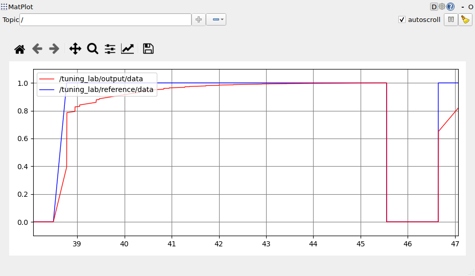

# 轮迹 · RM 调参实验台

第一次在 RoboMaster 队里调电机？从一只模拟车轮开始：先看它为什么追不上目标，再让滑台既能到位又能刹住，最后给自己的底盘模型加上负载。全程使用 ROS 2 Jazzy 和 rqt，一台带图形桌面的 Ubuntu 24.04 电脑或虚拟机就能练习。

**从这里开始 → [安装 ROS、下载项目、编译工作区](docs/first-wheel/README.md)。** 先完成教程第 1–3 步。看到 `1 package finished`，且 `ros2 pkg prefix rm_tuning_lab` 指向 `~/rm_ws/install/rm_tuning_lab` 对应的绝对路径，就可以做第一课。

[① 轮速 PI](#wheel) → [② 串级定位](#cascade) → [③ LQR 限力停车](#lqr) → [④ Kalman 测距](#kalman) → [⑤ 自定义负载](#load) → [⑥ 自定义后端](#backend)

## 每一课怎样开始、验收和换课

- **终端 A 启动本课。** 每开一个新终端，先执行下面两条命令，让它找到 ROS 和实验包。然后在 A 粘贴本课的启动命令，让窗口保持运行。
- **在 rqt 改参数。** 在 Parameter Reconfigure 左侧点 `tuning_lab`，右侧输入数值后按 Enter。曲线按图例中的话题名辨认。每次只改一个量，观察下一个完整的 8 秒周期。
- **在另一个终端验收。** 加载相同环境，执行下方验收命令，采样时保持参数不动。脚本会识别当前课，读满 400 拍并打印指标。对照轮显示「尚未通过」时，按本课参数表继续。最终一组显示 **本课最终验收：通过** 后再换课。回到 A 按 Ctrl+C；若另开过独立的 rqt_plot，也将它关闭，再启动下一课。

每个新终端都先执行：

```bash
source /opt/ros/jazzy/setup.bash
source ~/rm_ws/install/setup.bash
```

启动命令会打开参数和曲线两个窗口。第二、三、六课还要单独看速度、力或负载，可在另一个已加载环境的终端执行 `ros2 run rqt_plot rqt_plot -e`。在 Topic 框输入完整字段（如 `/tuning_lab/effort/data`），点右侧 **+**。

每课共用的验收命令：

```bash
python3 ~/rm_ws/src/rm-tuning-lab/tools/score_trial.py
```

<a id="wheel"></a>

## 第一课 · 轮速环为什么总差一点？

```bash
ros2 launch rm_tuning_lab lesson.launch.py case_id:=wheel_step
```

目标为 1 rad/s。先关掉积分和微分，把 `kp` 从 1 调到 3，看实际轮速的平台从约 0.50 升到 0.75 rad/s。保持 `kp=3`，把 `ki` 调到 3，观察末段误差怎样消失。

**进入下一课**：最后半秒轮速一直在 **0.99–1.01 rad/s**，阶跃后的峰值 **≤ 1.01 rad/s**。下一课会把这个速度环放进位置环里。[轮速环图文教程](docs/first-wheel/README.md#launch)

<details>
<summary>展开看第一课通过时的 rqt 曲线</summary>



这次复走中，蓝线 `reference` 是目标轮速，红线 `output` 是实际轮速。两条线一起归零时，新一轮开始。你的窗口可能使用其他颜色。

</details>

<a id="cascade"></a>

## 第二课 · 用速度内环完成位置定位

```bash
ros2 launch rm_tuning_lab lesson.launch.py case_id:=carriage_loops
```

先让位置外环保持较弱，对照速度指令 `speed_reference` 与实际速度 `velocity`，调内环积分。再固定内环，增加 `outer_kp`，切回位置图检查过冲。

**进入下一课**：目标从 0 跳到 1 m 后，**1.20 s 内**首次到达 0.90 m，最高位置 **≤ 1.05 m**，最后半秒每拍位置误差 **≤ 0.01 m**。[串级控制图文教程](docs/rqt-labs/cascade/README.md)

<a id="lqr"></a>

## 第三课 · LQR 怎样在推力预算内停车？

```bash
ros2 launch rm_tuning_lab lesson.launch.py case_id:=cart_stop
```

还是去 1 m，这次给电机 **2 N** 的推力预算。用一扇窗看位置，另一扇看 `effort`。固定位置权重，先调 `r_effort` 约束用力，再调 `q_velocity` 压低过冲。

**进入下一课**：同一轮中，力的绝对值峰值 **≤ 2.00 N**，阶跃后 **2.40 s 内**首次到 0.90 m，最高位置 **≤ 1.01 m**。[LQR 图文教程](docs/rqt-labs/lqr/README.md)

<a id="kalman"></a>

## 第四课 · Kalman 滤波能否既平稳又跟手？

```bash
ros2 launch rm_tuning_lab lesson.launch.py case_id:=range_step
```

在同一窗口比较仿真真值 `reference`、原始读数 `measurement` 和估计 `output`。先按传感器标准差设置测量方差 `r_measure`，再调每拍的过程方差 `q_process`。分别看跳变后的延迟和平稳段的抖动。

**进入下一课**：保留默认种子 7。真值跳变后 **0.30 s 内**估计首次到 0.90 m，最后 2 秒估计相对真值的均方根误差（RMSE）**≤ 0.09 m**。[Kalman 图文教程](docs/rqt-labs/kalman/README.md)

<a id="load"></a>

## 第五课 · 复制模板，给已有轮组加负载

先按[自定义教程第 1–2 步](docs/custom-chassis/README.md)复制模板到 `~/rm_models/chassis_lesson.py`，在副本中注册 `chassis_step_load`。完成后启动：

```bash
ros2 launch rm_tuning_lab lesson.launch.py case_id:=chassis_step_load plugin:="$HOME/rm_models/chassis_lesson.py"
```

第 4 秒起加入 **0.45 rad/s 的等效阻力**。保持 Kp 不变，比较加大 Ki 前后轮速跌到多低、多久恢复。

**进入下一课**：脚本确认负载工况符合，且四项同时达标：加载前半秒最大误差 **≤ 0.02 rad/s**；加载后最低轮速 **≥ 0.74 rad/s**；从加载起 **1.20 s 内**回到 **0.98–1.02 rad/s** 并保持至周期末；最后半秒最大误差 **≤ 0.01 rad/s**。

<a id="backend"></a>

## 第六课 · 写自己的驱动后端，验收重载底盘

在 A 停掉上一课。按[自定义教程第 3 步](docs/custom-chassis/README.md#drive-backend)在同一副本里追加驱动滞后模型，再启动新实例：

```bash
ros2 launch rm_tuning_lab lesson.launch.py case_id:=chassis_drive_lag plugin:="$HOME/rm_models/chassis_lesson.py"
```

在独立曲线窗比较指令 `effort`、实际驱动 `drive_actual` 和阻力 `load`。先在原来的 0.45 负载下比较两种后端，然后把 `load_drag` 增至 0.90。先用 Kp 处理掉速，再用 Ki 缩短恢复时间。

**结课**：确认验收的是自己副本里的 `chassis_drive_lag`；在 **0.90 rad/s 等效阻力**下，通过第五课相同的四项轮速指标。你现在可以改一个工况、注册自己的模型，并用同一组指标比较前后结果。[重载实测曲线与逐轮结果](docs/custom-chassis/README.md#chassis-results)

**核对自己的结果**：本路线在未预装 ROS 的 Ubuntu 24.04.5（arm64）容器中，从普通账户安装 Jazzy 并编译。用虚拟显示器打开 rqt，按课次在参数框输入数值、查看曲线，用同一工作区走完六课。可以按课名和轮次对照[20 轮参数与实测验收输出](docs/route-acceptance.txt)。

## 继续练习

- 从[25 个内置实验](docs/catalog.md)挑一个新工况，用[四个基础问题](docs/lessons.md)练习读曲线。已有工作区的队员可以查[多窗口操作与故障排查](docs/rqt-labs/README.md)。
- 如果手边只有 Python 3.9+，在仓库根目录运行 `python3 web_lab.py` 并打开 <http://127.0.0.1:8765>，可以用相同模型对照参数。上面六课的实时验收在 ROS 环境中完成。
- 写插件时可查[接口字段说明](docs/plugins.md)、[起始模板](examples/custom_lab.py)和[重载参考答案](examples/loaded_chassis.py)。根目录运行 `python3 -m unittest discover -s tests -v` 可验证模型。

项目采用 [MIT 许可证](LICENSE)。
