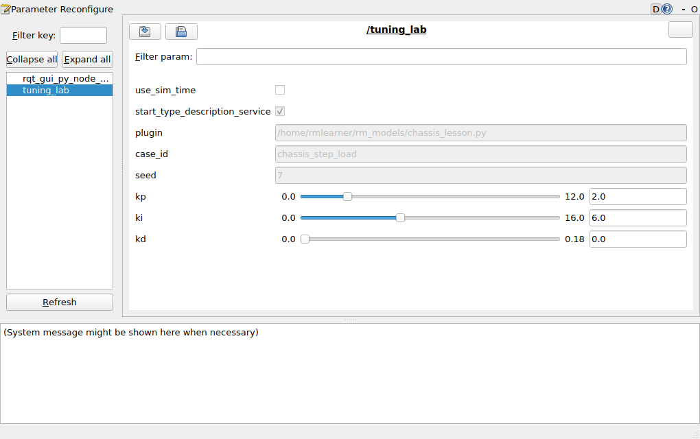
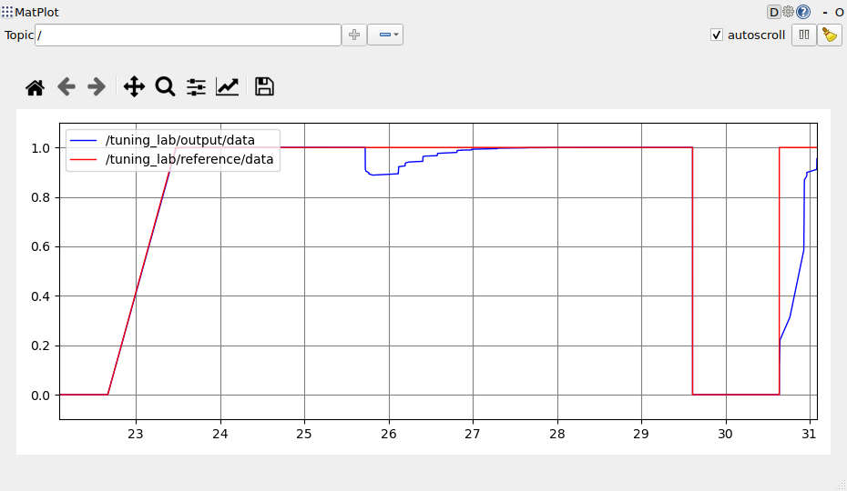
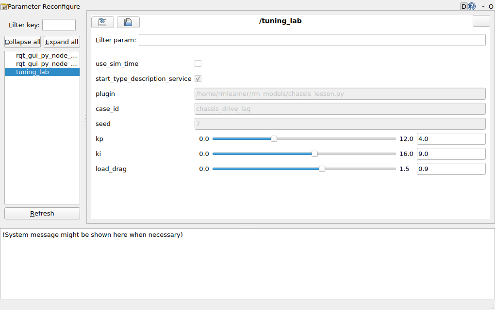
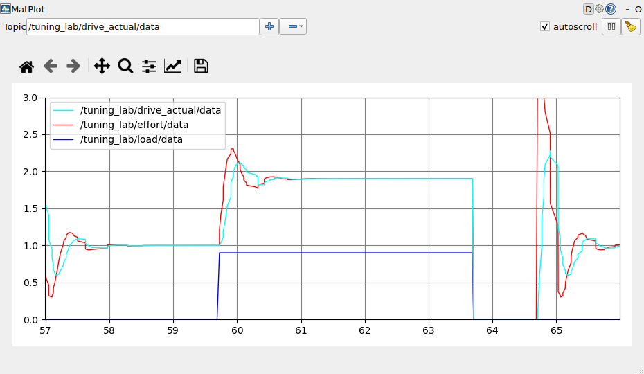
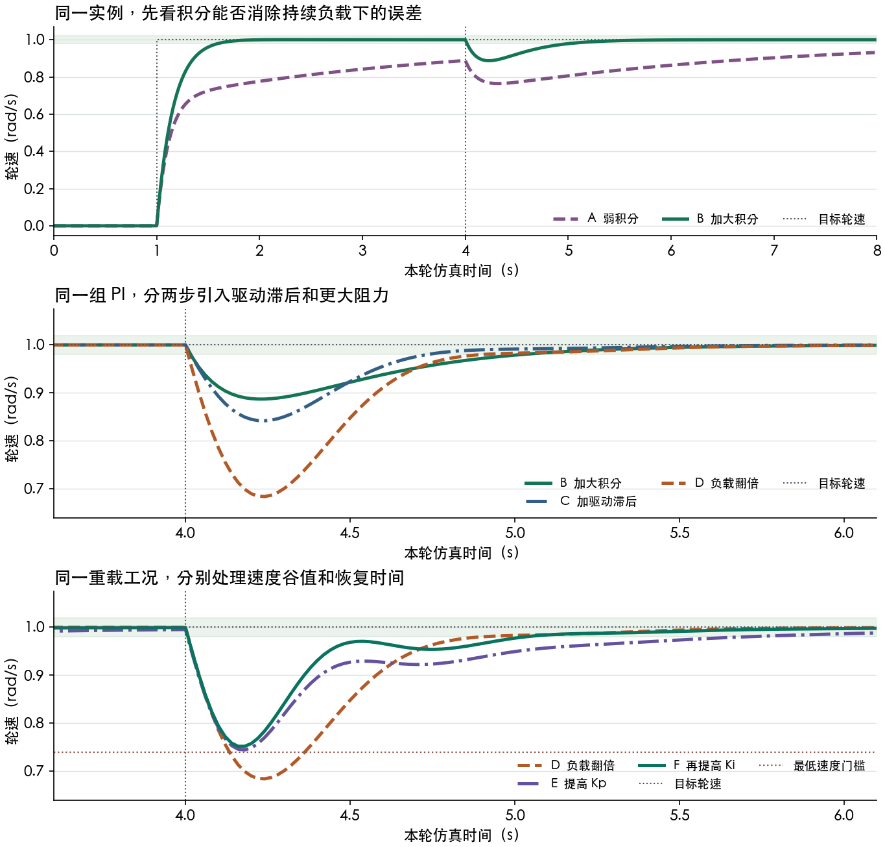

# 从模板到自己的底盘轮组：在 rqt 里调出加载后的恢复能力

设想底盘第 4 秒驶入阻力更大的路段。你要让轮速在扰动后回到 **1 rad/s**。先给现成轮组换一个负载场景；再写自己的驱动模型，让“控制器刚下达的指令”和“车轮实际收到的驱动”之间有 0.10 s 的时间常数。两次练习用同一个插件副本，加载到同一个 rqt 实验台。

| 你要改什么 | 这一课的做法 | 成功加载的标志 |
|---|---|---|
| 场景和参数，沿用已有动力学 | 在 `CASES` 中增加 `chassis_step_load`，复用 `wheel(...)` | 参数面板中有 `kp, ki, kd` |
| 每一拍怎样推进状态、发布哪些量 | 写 `lagged_wheel`，再用 `Case` 注册 `chassis_drive_lag` | 面板出现 `load_drag`，曲线列表多出 `drive_actual` 和 `load` |

这里的驱动和阻力都换算成**等效轮速**（rad/s）。负载数值 0.45 或 0.90 表示模型里的持续阻力大小。换算成实车上的质量或力矩还需要电机、传动和车轮参数。

## 1. 复制模板，先证明副本能加载

第一次使用 ROS 请先完成[轮速环安装教程](../first-wheel/README.md)。本课沿用 Ubuntu 24.04、ROS 2 Jazzy 和 `~/rm_ws`。在终端 A 更新工具、编译并加载环境：

```bash
cd ~/rm_ws/src/rm-tuning-lab
git pull --ff-only
source /opt/ros/jazzy/setup.bash
cd ~/rm_ws
colcon build --symlink-install --packages-select rm_tuning_lab
source ~/rm_ws/install/setup.bash
```

将模板复制到自己的目录。接下来的追加命令都写入这份副本。第一次请用一个新文件；重复练习时可继续使用已有副本，跳过已经追加过的代码块。

```bash
mkdir -p ~/rm_models
cp --update=none ~/rm_ws/src/rm-tuning-lab/examples/custom_lab.py ~/rm_models/chassis_lesson.py
python3 - <<'PY'
from pathlib import Path
from rm_tuning_lab.plugins import catalog
path = Path.home() / "rm_models/chassis_lesson.py"
cases = catalog(str(path))
print(path)
print(cases["slow_wheel"].title, cases["tank"].title)
PY
```

应看到副本的绝对路径和两个模板实验的中文标题。若提示缺少 `rm_tuning_lab`，在当前终端重新执行上面两条 `source` 命令。

## 2. 自定义实例：换成第 4 秒起持续加载的底盘轮组

在 A 粘贴整块。模板已经导入了 `pid`、`wheel`、`Case`、`Knob` 和 `DT`。新增实例只指定轮组时间常数 **0.35 s**，以及从第 4 秒起恒为 **0.45 rad/s** 的阻力。轮速目标沿用默认设置，在第 1 秒从 0 跳到 1 rad/s。

```bash
cat >> ~/rm_models/chassis_lesson.py <<'PY'

def floor_drag(t):
    return 0.45 if t >= 4.0 else 0.0


CASES["chassis_step_load"] = pid(
    "底盘轮组 · 持续阻力",
    "4 秒进入阻力段，对照积分增益改变前后的掉速与恢复。",
    wheel(tau=0.35, load=floor_drag),
)
PY
```

先检查语法，再启动副本里的新实例：

```bash
python3 -m py_compile ~/rm_models/chassis_lesson.py
ros2 launch rm_tuning_lab lesson.launch.py case_id:=chassis_step_load plugin:="$HOME/rm_models/chassis_lesson.py"
```

在 **Parameter Reconfigure** 左侧选 `tuning_lab`，右侧白框里 Ctrl+A、输入数值、按 Enter 提交。曲线图的 `reference/data` 是目标，`output/data` 是真实的模拟轮速。先做 A、B 两轮：

| 轮次 | 在 rqt 中输入 | 要观察的地方 |
|---|---|---|
| A | `kp=2.0, ki=1.0, kd=0.0` | 看加载前速度是否已经跟上。再看第 4 秒后的最低点和周期末端。 |
| B | 保持 Kp 和 Kd，只把 **Ki 改为 6.0** | 同一个路段再次加载。比较两轮回到目标附近并保持住的时间。 |



*图中是 B 轮。第 4 秒只改变负载，目标线仍在 1；从此处向下凹的是响应线。*

### 每一轮都怎样跑验收？

保持终端 A 和 rqt 开着。新开**终端 C**，运行以下三行。下文每次改完一组参数，都在 C 重跑最后一行，等打印结果后再继续调。

```bash
source /opt/ros/jazzy/setup.bash
source ~/rm_ws/install/setup.bash
python3 ~/rm_ws/src/rm-tuning-lab/tools/score_trial.py
```

脚本会等一个完整的 **8 s、400 拍** 周期，采样期间保持参数不变。在 C 执行 `ros2 param get /tuning_lab plugin` 可以确认实际加载的是自己编辑的文件。要留存本轮结果，在验收命令末尾加 `--csv ~/rm_models/my_trial.csv`，不同轮次用不同文件名。

**两种模型的四项验收条件**：加载前最后半秒速度与目标的最大误差 ≤ **0.02 rad/s**；加载后最低速度 ≥ **0.74 rad/s**；从第 4 秒起 **1.20 s** 内回到 **0.98–1.02 rad/s** 且直到周期末都留在带内；最后半秒最大误差 ≤ **0.01 rad/s**。此外，复用实例须确实加载 0.45，自写后端的结课工况须加载 0.90。第一阶段沿用内置后端，它只发布轮速和指令；脚本用相邻两拍轮速、指令及已知的 0.35 s 时间常数反算负载。第二阶段直接核对新增的 load 话题。这样能发现负载函数没生效或忘记切换重载。



## 3. 自定义后端：把驱动响应滞后写进模型

先回 A 按 **Ctrl+C** 退出旧节点。下面整块追加到同一份副本。注意 Python 的缩进和最后一行独占一行的 `PY`。

```bash
cat >> ~/rm_models/chassis_lesson.py <<'PY'

from math import exp


def lagged_wheel(rng):
    speed = drive = integral = 0.0
    wheel_gain = 1.0 - exp(-DT / 0.35)
    drive_gain = 1.0 - exp(-DT / 0.10)

    def step(t, p):
        nonlocal speed, drive, integral
        target = float(t >= 1.0)
        load = p["load_drag"] if t >= 4.0 else 0.0
        error = target - speed
        candidate = integral + DT * error
        raw = p["kp"] * error + p["ki"] * candidate
        command = max(-3.0, min(3.0, raw))
        if (raw - command) * error <= 0.0:
            integral = candidate

        row = dict(reference=target, output=speed, effort=command,
                   drive_actual=drive, load=load)
        speed += wheel_gain * (drive - load - speed)
        drive += drive_gain * (command - drive)
        return row

    return step


CASES["chassis_drive_lag"] = Case(
    "底盘轮组 · 驱动滞后", "PI", "rad/s",
    "固定同一组 PI，先改变路面负载，再调 PI。",
    {"kp": Knob("Kp · 比例", 2.0, 0.0, 12.0),
     "ki": Knob("Ki · 积分", 6.0, 0.0, 16.0),
     "load_drag": Knob("等效负载 · rad/s", 0.45, 0.0, 1.5)},
    lagged_wheel, ("reference", "output", "effort", "drive_actual", "load"),
    "rad/s",
)
PY
```

**顺着一次采样读代码**：

1. `lagged_wheel(rng)` 只在新一轮开始或 reset 时调用，初始化轮速、实际驱动和积分。把初始值放在这里，状态就能在同一轮的 400 拍中保留。
2. 每隔 `DT=0.02 s` 调一次 `step(t, p)`。它取最新参数，算速度误差、积分候选值和 PI 指令，并把指令限制在 ±3。指令饱和且误差还会把它推向更深饱和时，积分保持原值。
3. `row` 保存本拍的状态。`speed` 用本拍实际驱动减去阻力来更新；`drive` 再向新指令靠近。负载阶跃时，控制器能立即提高 `effort`，而 `drive_actual` 需要时间跟上。
4. `Knob` 里的默认值、下限和上限生成 rqt 输入框。`signals` 中的名字生成 ROS 话题，必须和返回字典里的键一致。这个确定性后端保留工厂接口规定的 `rng` 参数。

重新检查文件并启动新 ID。每次改 Python 逻辑都要重启节点；仅在 rqt 改数值则会在下一拍生效。

```bash
python3 -m py_compile ~/rm_models/chassis_lesson.py
ros2 launch rm_tuning_lab lesson.launch.py case_id:=chassis_drive_lag plugin:="$HOME/rm_models/chassis_lesson.py"
```

用主图看 `reference` 与 `output`。再开**终端 B**专看驱动力传递：

```bash
source /opt/ros/jazzy/setup.bash
source ~/rm_ws/install/setup.bash
ros2 run rqt_plot rqt_plot -e
```

在 B 窗口顶部 **Topic** 框依次输入 `/tuning_lab/load/data`、`/tuning_lab/effort/data`、`/tuning_lab/drive_actual/data`，每条都点一次 **+**。先找第 4 秒的负载台阶，再看指令和实际驱动如何分开、重新靠拢。rqt 横轴是接收时间，可以把负载跳变当作零点；验收脚本直接使用节点发布的本轮时间。



| 轮次 | 只改变什么 | 带着什么问题读图 |
|---|---|---|
| C · 相同负载 | 新后端设 `kp=2.0, ki=6.0, load_drag=0.45` | 对照 B。轮组时间常数、负载和 PI 一样，实际驱动多了一拍一拍的跟随过程，最低速度怎样变？此轮用于对照，验收会提示未达到结课负载。 |
| D · 加重路面阻力 | 只把 **load_drag 改为 0.90** | 目标轮速仍是 1 rad/s，负载台阶翻倍；看轮速最低点。后续各轮保持这个负载。 |
| E · 先缓解掉速 | 只把 **kp 改为 4.0** | 比较 D、E 的速度谷值。即使谷值已合格，还要看恢复是否拖得太久。 |
| F · 再缩短恢复 | 只把 **ki 改为 9.0** | 在相同重载下跑验收，确认谷值、恢复时间、前后稳态误差都达标。 |



## 4. 用实测记录核对自己的曲线

以下速度和误差单位均为 rad/s。C 轮的动态指标可对照 B、D 阅读，工况核对会指出它使用轻载。

| 轮次 | 加载前最大误差 | 加载后最低速度 | 相对加载瞬间掉速 | 恢复时间 | 末半秒最大误差 | 本轮验收 |
|---|---:|---:|---:|---:|---:|---|
| A | 0.13286 | 0.7645 | 0.1238 | 周期内未恢复 | 0.08150 | 未通过 |
| B | 0.00002 | 0.8872 | 0.1128 | 1.04 s | 0.00001 | 通过 |
| C | 0.00003 | 0.8421 | 0.1579 | 0.74 s | 0.00001 | 轻载对照 |
| D | 0.00003 | 0.6841 | 0.3159 | 0.92 s | 0.00001 | 未通过 |
| E | 0.00917 | 0.7445 | 0.2508 | 1.70 s | 0.00183 | 未通过 |
| F | 0.00159 | 0.7519 | 0.2476 | 1.04 s | 0.00012 | 通过 |

**轮组反应变慢之后，原来的增益还够用吗？** B 与 C 负载相同，只换后端，最低轮速从 0.8872 降到 0.8421 rad/s。D 把负载翻倍后跌破门槛。E 提高 Kp，谷值回到合格区间，恢复却用了 1.70 s。F 再把 Ki 加到 9.0，恢复缩短至 1.04 s，四项同时通过。



“相对加载瞬间掉速”用第 4 秒轮速减去之后的最低轮速；例如 A 轮在负载到来时还没到目标，不能把 `1 − 最低轮速` 当成实际掉速。恢复时间从第 4 秒开始计，第一次擦过容差带后又出去的时刻不算恢复。

## 5. 结果对不上时先查哪里？

| 现象 | 检查动作 |
|---|---|
| 启动提示未知实例，或仍显示上一课的参数 | 检查两处拼写：插件绝对路径和 `case_id`。在 C 执行 `ros2 param get /tuning_lab case_id` 和 `ros2 param get /tuning_lab plugin`；在 A 停掉旧节点，加载刚编辑的副本。 |
| `SyntaxError` / `IndentationError`，或启动后没有数据 | 先单独跑 `python3 -m py_compile ~/rm_models/chassis_lesson.py`，按报错行核对缩进。若日志说输出信号不齐，核对 `row` 和 `Case` 的信号列表。 |
| 在第二阶段看不到 `load_drag`，或 rqt 的 + 是灰的 | Param 窗口点 Refresh 后选中 `tuning_lab`。确认新 ID 是 `chassis_drive_lag`，B 的字段名末尾有 `/data`。 |
| 调参后曲线会周期性归零，或验收仍提示工况不符 | 每 8 秒从静止重跑。确认输入后按了 Enter、重载值为 0.90，等完整一轮。若验收工具不认识实例 ID，按第 1 步更新仓库，并运行该仓库里的脚本。 |

做完后，在 A 和 B 分别按 Ctrl+C 关闭仿真与独立曲线窗。实测使用本机 Ubuntu 24.04 ARM64 容器、ROS 2 Jazzy、Xvfb 图形显示和普通用户工作区；参数由 Qt 点击、键入和回车写入真实 rqt 面板。两次启动回读的插件路径都指向学习者的副本。六轮共采集 2400 拍，CSV 中复用实例没有发布的字段留空。

[可直接运行的参考答案](../../examples/loaded_chassis.py) · [六轮原始 CSV](samples.csv) · [自定义接口字段速查](../plugins.md)
