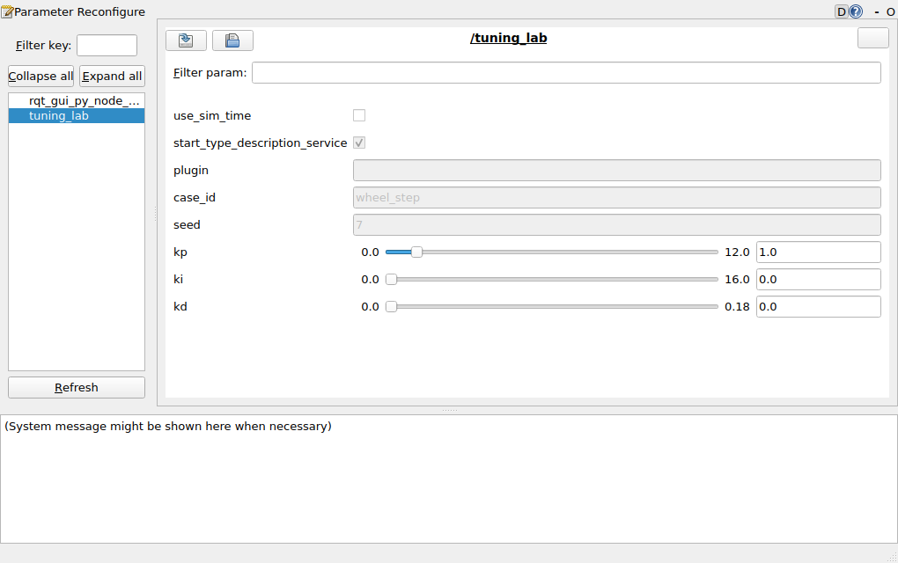
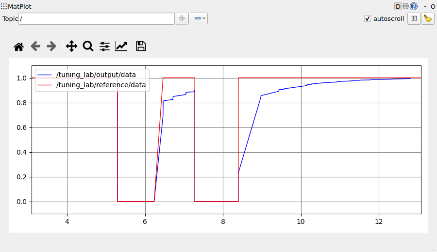
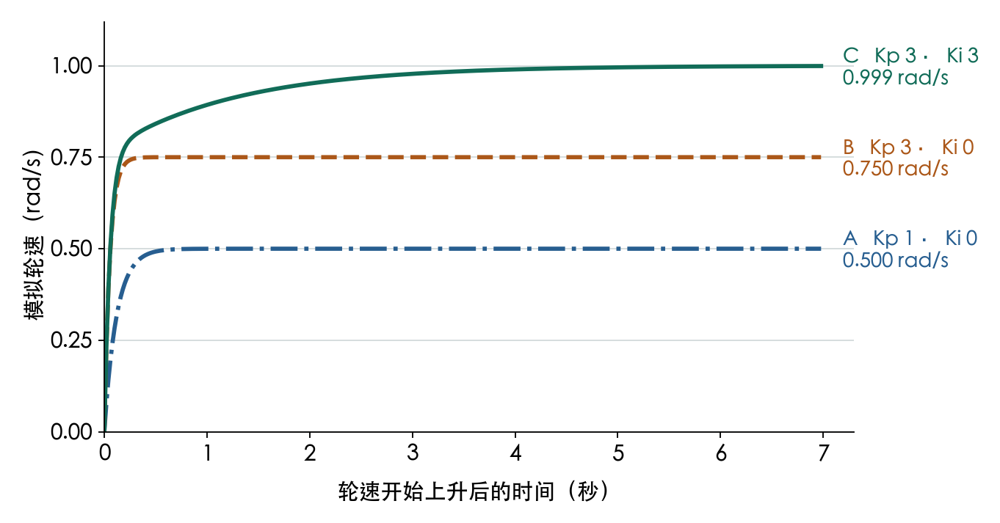

# 第一次用 ROS：在 rqt 里调好一个轮速环

这节课只做一件事：给模拟车轮下达 **1 rad/s** 的目标，让它能跟上并保持住。你会亲手看到，单靠比例控制，轮速停在 **0.50** 或 **0.75**；加入积分后，同一台模拟电机可以接近 **1.00 rad/s**。

准备一台能打开图形窗口的 **Ubuntu 24.04** 电脑或虚拟机，使用普通账户和 Bash，需要联网和 sudo 权限。如果从 Windows 或 macOS 开始，可先准备 Ubuntu 24.04 桌面虚拟机，再在虚拟机的终端执行命令。不用接电机、C 板或机器人。已编译过本项目的队员可直接跳到[打开两个窗口](#launch)。

## 1. 先确认自己的系统

在 Ubuntu 桌面按 **Ctrl + Alt + T**，打开**终端 A**。下面每块命令都可以整块复制，在终端里用 **Ctrl + Shift + V** 粘贴，按回车。输入 sudo 密码时，屏幕不会显示字符，输完按回车即可。

```bash
. /etc/os-release
echo "$PRETTY_NAME / $VERSION_CODENAME"
dpkg --print-architecture
locale charmap
```

看到 **Ubuntu 24.04、noble**，架构为 **amd64** 或 **arm64**，再继续。这里使用的 ROS 发行版叫 **Jazzy**。如果显示 22.04 或 jammy，请打开一台 24.04 的 Ubuntu 环境，两个版本的软件源不能混用。若最后一行是 UTF-8，保留当前中文或英文语言设置即可。

## 2. 安装 ROS、画图工具和参数面板

仍在**终端 A**。Ubuntu 的软件管理器需要先知道去哪里找 ROS 软件包。

```bash
sudo apt update
sudo apt install -y curl ca-certificates git software-properties-common locales
sudo add-apt-repository -y universe
```

仅当上一步的 `locale charmap` 没显示 UTF-8 时，执行下面这块，让当前终端使用 UTF-8：

```bash
sudo locale-gen en_US.UTF-8
export LANG=en_US.UTF-8
locale charmap
```

用 ROS 官方提供的软件源配置包添加 Jazzy 软件源。在**同一个终端**执行整块命令，以便后两行能读到版本号。

```bash
ros_source_version=$(curl -fsSL --retry 3 --retry-all-errors -o /dev/null -w '%{url_effective}' https://github.com/ros-infrastructure/ros-apt-source/releases/latest)
ros_source_version=${ros_source_version##*/}
curl -fL --retry 3 --retry-all-errors -o /tmp/ros2-apt-source.deb "https://github.com/ros-infrastructure/ros-apt-source/releases/download/${ros_source_version}/ros2-apt-source_${ros_source_version}.noble_all.deb" && sudo dpkg -i /tmp/ros2-apt-source.deb
```

若 GitHub 下载中断（例如反复显示 `curl: (35)`），可从 [ROS 官方软件包目录](https://repo.ros2.org/ubuntu/main/pool/main/r/ros-apt-source/)下载这次复走使用的 Noble 配置包。下列命令会按该版本发布的 SHA-256 校验下载文件，校验成功后才安装：

```bash
curl -fL --retry 3 --retry-all-errors -o /tmp/ros2-apt-source.deb 'https://repo.ros2.org/ubuntu/main/pool/main/r/ros-apt-source/ros2-apt-source_1.3.0~noble_all.deb' &&
echo 'f31d84adf5054c7d60ded0e82c0f776a77ea33af53d08f40b9ad7c94cca55296  /tmp/ros2-apt-source.deb' | sha256sum -c - &&
sudo dpkg -i /tmp/ros2-apt-source.deb
```

看到 `Setting up ros2-apt-source` 再继续。如果后面提示找不到 `ros-jazzy-ros-base`，检查配置包是否安装成功，以及 `apt update` 的输出是否包含 ROS 软件源。软件包较多，请等安装结束。

```bash
sudo apt update
sudo apt install -y ros-jazzy-ros-base ros-jazzy-rqt-plot ros-jazzy-rqt-reconfigure python3-colcon-common-extensions python3-matplotlib
source /opt/ros/jazzy/setup.bash
echo "$ROS_DISTRO"
ros2 pkg prefix rqt_reconfigure
```

**安装检查点**：最后两条命令应分别显示 `jazzy` 和 `/opt/ros/jazzy`。这里的 `source` 是把命令和软件包的位置载入当前终端。安装只需一次，新开的终端仍然要加载环境。[ROS 官方 Jazzy 安装指南](https://docs.ros.org/en/jazzy/Installation/Ubuntu-Install-Debs.html)

## 3. 下载项目，编译一次

`~/rm_ws` 是这节课的**工作区**。源码放在 `src`，编译出来的包放在 `install`。在**终端 A**运行：

```bash
mkdir -p ~/rm_ws/src
git clone https://github.com/lazyerZZZ/rm-tuning-lab.git ~/rm_ws/src/rm-tuning-lab
cd ~/rm_ws
colcon build --symlink-install --packages-select rm_tuning_lab
source ~/rm_ws/install/setup.bash
ros2 pkg prefix rm_tuning_lab
```

**编译检查点**：找到 `1 package finished`，最后一条命令应给出你主目录下的 `rm_ws/install/rm_tuning_lab`。仓库目录名用连字符 `rm-tuning-lab`，ROS 包名用下划线 `rm_tuning_lab`。如果以前已成功下载，可以从 `cd ~/rm_ws` 继续。下面是复走时的终端输出，你的用户名和耗时会不同。

```text
Summary: 1 package finished [1.05s]
/home/trainee/rm_ws/install/rm_tuning_lab
```

<a id="launch"></a>

## 4. 打开两个窗口，认出哪条线是轮速

在**终端 A**启动。这里也写出两个 `source`，方便下次开机直接从这一步开始。

```bash
source /opt/ros/jazzy/setup.bash
source ~/rm_ws/install/setup.bash
ros2 launch rm_tuning_lab lesson.launch.py case_id:=wheel_step
```

ROS 把运行轮组仿真的程序称为**节点**，这里叫 `/tuning_lab`。节点把目标和实际轮速发布到两条**话题**，画图工具订阅它们；`kp`、`ki`、`kd` 是节点运行时可以更改的**参数**。

终端 A 会一直显示运行日志，**让它保持运行**。稍等片刻，桌面会出现两个窗口，重叠时可用 **Alt + Tab** 切换。

| 窗口 | 现在做什么 |
|---|---|
| **Parameter Reconfigure / rqt_reconfigure** | 单击左侧节点树里的 `tuning_lab`。右侧标题应为 `/tuning_lab`，参数行里有小写的 `kp`、`ki`、`kd`。点数值框，Ctrl + A 选中旧值，输入新数，按 **Enter** 提交。 |
| **MatPlot / RM tuning curves** | 按图例认线。`/tuning_lab/reference/data` 是目标，`/tuning_lab/output/data` 是模拟轮速。横轴是接收时间（秒），纵轴是轮速（rad/s）。不同会话的颜色可能互换。 |



*图中已完成 A 轮设置。左边蓝色行是选中的节点。右边三行最右侧的白框从上到下分别是 kp、ki、kd，读数为 1.0、0.0、0.0。顶部的 Filter key 和 Filter param 是搜索框。*



*沿着目标线找从 0 跳到 1 的竖边。它右侧的实际轮速才是本轮的响应。*

## 5. 做三轮，每次只回答一个问题

程序每 **8 秒**自动重跑：本轮开始先静止 **1 秒**，随后目标从 0 跳到 1。在运行中改参数会立即影响当前轮。**每次输完，等下一次目标从 0 跳到 1，再看这一整轮**。要停住画面读数，可以点曲线窗口右上角的暂停键；下一轮前再点一次恢复。

| 轮次 | 在 Param 窗口输入，逐格按 Enter | 看曲线回答 |
|---|---|---|
| A · 只开比例 | 先设 `ki=0.0`、`kd=0.0`，再设 `kp=1.0` | 目标为 1，输出停在约 **0.50**。继续等，差距会自己消失吗？ |
| B · 加大比例 | 只把 `kp` 改为 `3.0` | 最终约 **0.75**。比上一轮更接近，但仍差四分之一。 |
| C · 加入积分 | 保持 `kp=3.0` 和 `kd=0.0`，只把 `ki` 改为 `3.0` | 先快速升起，再逐渐贴近目标。比较周期末端与 B 的平台。 |

比例控制按当前误差给驱动。这个轮组维持非零转速需要持续驱动，因此只用比例时会留下误差。积分把之前的误差累积成驱动，让车轮在当前误差很小时仍能维持转速。这个无噪声阶跃任务用 PI 就能完成，Kd 可以保持为零。



*图中三条线取自实际 ROS 节点的 output 话题，按轮速开始上升的时刻对齐。三轮均在 rqt 参数面板输入增益，每轮记录 400 个采样点。*

**怎样算调好了？** 本课约定：C 轮目标跳变后，在下次归零前的最后半秒，轮速持续落在 **0.99–1.01 rad/s**，且阶跃期间峰值不超过 **1.01 rad/s**。把曲线窗口拉宽，先确认 A、B 的平台高度，再看 C 的末端能否贴住目标线。本次 C 轮最后半秒实测为 **0.99856–0.99901 rad/s**，全程峰值为 **0.99901 rad/s**，通过上述标准。这个标准用于本节的无负载模拟轮组；真实电机还会受到摩擦、传感器噪声和负载变化的影响。

### 想确认输入是否生效，或立即重跑？

再按 **Ctrl + Alt + T** 打开**终端 B**。让 A 继续运行。在 B 里执行：

```bash
source /opt/ros/jazzy/setup.bash
source ~/rm_ws/install/setup.bash
ros2 param get /tuning_lab kp
ros2 param get /tuning_lab ki
ros2 param get /tuning_lab kd
```

C 轮应依次读到 **3.0、3.0、0.0**。要按上面的标准验收，可在 B 运行 `python3 ~/rm_ws/src/rm-tuning-lab/tools/score_trial.py`，保持参数不变，等它打印最后半秒的轮速范围和阶跃峰值。以下命令让车轮立刻回到静止，并保留当前三个参数。看到 `success=True` 后，回到曲线窗口观察新一轮：

```bash
ros2 service call /tuning_lab/reset std_srvs/srv/Trigger '{}'
```

要看轮速的更多小数位，在 B 运行 `ros2 topic echo /tuning_lab/output --field data`。这里会连续打印读数，周期边界会回到 0。只在 B 按 **Ctrl + C** 可以停止打印，A 里的仿真仍会继续。

## 6. 第一次最容易卡在哪里？

| 看到的现象 | 从这里恢复 |
|---|---|
| `Unable to locate package ros-jazzy-...` | 先核对 `noble`。运行 `dpkg -s ros2-apt-source`，应有 `Status: install ok installed`。若未安装，重新执行第 2 步下载配置包；若已安装，检查 `sudo apt update` 中 ROS 源的网络或签名报错，再用 `apt-cache policy ros-jazzy-ros-base` 确认有 Candidate 版本。 |
| 新终端提示 `ros2: command not found` 或 `Package 'rm_tuning_lab' not found` | 在当前终端执行第 4 步两条 `source`。若第二个文件不存在，回到 `~/rm_ws` 完成第 3 步。 |
| 启动后只有日志，提示 `could not connect to display` | 在 Ubuntu 图形桌面的终端运行，输入 `echo "$DISPLAY $WAYLAND_DISPLAY"` 检查图形会话。纯 SSH 或无桌面终端请切回有桌面的会话。 |
| Param 窗口左边没有 `tuning_lab`，或右边空白 | 清空左上角筛选框，点左下角 **Refresh**，再单击节点。也可在 B 执行 `ros2 node list`。如果连 B 也看不到 `/tuning_lab`，检查 A 是否仍在运行，两终端是否使用相同的 `ROS_DOMAIN_ID`。 |
| B 第一次查询报 `Node not found`，A 和图形窗口仍在运行 | 新终端的 ROS 命令可能还在发现节点。等几秒，再运行 `ros2 node list`，直到出现 `/tuning_lab` 后重试 `ros2 param get`。如果持续为空，再核对两终端的环境和 A 的启动日志。 |
| 有图例但曲线不动，或只看见一条线 | 恢复暂停、勾选 autoscroll，从一次完整阶跃观察；末段两线可能重合。在 B 运行 `ros2 topic echo /tuning_lab/output --once`。手动加曲线时输入 **`/tuning_lab/output/data`** 再点 **+**；终端订阅则使用话题名 **`/tuning_lab/output`**。 |
| 改完看不出区别，或者读到的值又变成零 | 数值框内按 Enter，再在 B 用 `ros2 param get` 回读。轮速每 8 秒归零是下一轮开始；重置服务会保留增益，关闭并重新启动节点会恢复默认增益。 |

**收工和复做**：把本次通过的 `kp=3.0, ki=3.0, kd=0.0` 记下来，在终端 A 按 **Ctrl + C** 关闭仿真和两个窗口。下次从第 4 步启动，重新输入这组参数即可。想看轮子遇到阻力时是否还跟得上，可继续做[轮组持续负载实验](../catalog.md)。

轮速环完成后，下一步可以[让速度内环驱动位置外环](../rqt-labs/cascade/README.md)，或按[三次 rqt 实验目录](../rqt-labs/README.md)选课。

**复走环境**：Ubuntu 24.04.5（amd64）干净容器，普通用户安装 ROS 2 Jazzy，在 Xvfb 虚拟显示器中运行 rqt 图形窗口。可在运行日志核对安装、编译、参数回读和三轮输出；实拍面板和原始 CSV 位于该次运行的 first-wheel-evidence 附件。[完整复走记录](https://github.com/lazyerZZZ/rm-tuning-lab/actions/runs/44594479469)
