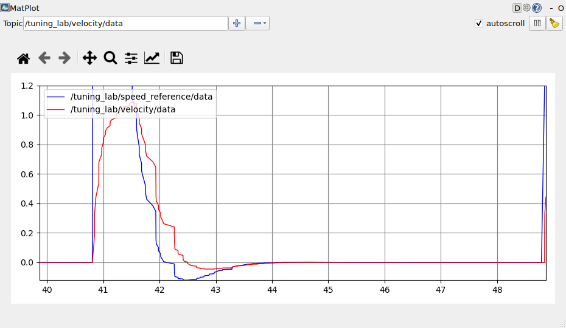
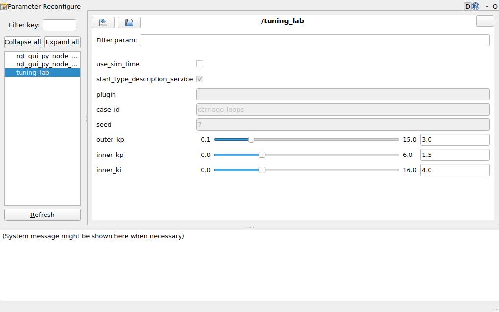
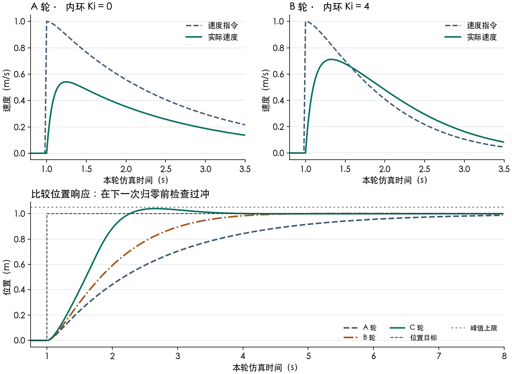

# 串级控制：先让滑台跟上速度，再让它停到 1 m

位置外环每拍都在问“离目标还有多远”，据此下达速度指令；速度内环根据实际速度计算驱动。旋钮在同一面板，影响的却是不同的两段响应。本课固定内环比例增益，先用积分改善速度跟随，再提高外环比例缩短定位时间。

**任务标准**：目标从 0 跳到 1 m 后，**1.20 s 内**首次到达 0.90 m，位置峰值不超过 **1.05 m**，本轮最后 0.5 s 每个采样点的位置误差都在 **±0.01 m** 内。这是本节模拟滑台的教学要求。

## 1. 打开位置、速度两组曲线

首次安装见[轮速环入门](../../first-wheel/README.md)。已有工作区先按[实验准备](../README.md)更新一次。在终端 A 运行并保持它开启：

```bash
source /opt/ros/jazzy/setup.bash
source ~/rm_ws/install/setup.bash
ros2 launch rm_tuning_lab lesson.launch.py case_id:=carriage_loops
```

默认曲线窗口显示 `reference/data`（目标位置，m）与 `output/data`（实际位置，m）。开终端 B，单独画速度（m/s）：

```bash
source /opt/ros/jazzy/setup.bash
source ~/rm_ws/install/setup.bash
ros2 run rqt_plot rqt_plot -e
```

在 B 的窗口顶部 **Topic** 框依次输入 `/tuning_lab/speed_reference/data` 和 `/tuning_lab/velocity/data`，每条都点一次 **+**。第一条是外环给内环的速度指令，第二条是实际速度。看图例里的名字识别曲线。两扇窗口的纵轴单位不同。



*速度图里先看实际速度落后指令多少，再看减速时是否跟得上。最终 C 轮在接近目标时短暂给出负速度，滑台回到目标附近。*

## 2. 弱外环下比较速度，再看位置过冲

在 Parameter Reconfigure 左侧单击 `tuning_lab`。用每行最右侧的白框输入数值，每次按 Enter 提交。等下一轮从静止开始再观察。



*面板实拍为最终的 C 轮；第一次练习先按表中 A 轮输入。*

| 轮次 | 怎么改 | 看哪条线，为什么 |
|---|---|---|
| A · 内环只开比例 | 设 `outer_kp=1.0`、`inner_kp=1.5`、`inner_ki=0.0` | 看 B 窗口：位置目标跳变后，速度指令先升高，实际速度起步落后。回 A 窗口看位置爬升有多慢。 |
| B · 加内环积分 | 只把 `inner_ki` 改成 **4.0** | 对比 A、B 各自的速度目标与实际速度。位置改变后，外环下达的速度指令也会变；所以用同一轮的两条速度线计算误差。 |
| C · 提高外环增益 | 保持内环 `1.5 / 4.0`，只把 `outer_kp` 从 1 改成 **3.0** | 切回位置图，对照 0.90 m 到达时间和最高点。速度目标最高到 1.2 m/s，开头出现平顶是模型的限速。 |



## 3. 对照读数，再验收

| 轮次 | 速度 RMSE（m/s） | 首达 0.90 m（s） | 位置峰值（m） | 末半秒最大误差（m） |
|---|---:|---:|---:|---:|
| A | 0.2900 | 3.72 | 0.9874 | 0.017132 |
| B | 0.2038 | 2.04 | 1.0018 | 0.000374 |
| C | 0.3033 | 1.04 | 1.0403 | 0.000002 |

**C 轮通过。** A → B 保持相同的外环增益，前两秒的速度跟随误差从 0.2900 降到 0.2038 m/s；B 轮的位置仍需 2.04 s 才到 0.90 m。C 轮加强外环后用时 1.04 s，最高 1.0403 m，满足 5 cm 的过冲预算。

在终端 C 加载环境并运行验收。每换一组参数运行一次，采样期间保持参数不变：

```bash
source /opt/ros/jazzy/setup.bash
source ~/rm_ws/install/setup.bash
python3 ~/rm_ws/src/rm-tuning-lab/tools/score_trial.py
```

速度误差取本轮第 1 至 3 秒（不含 3 秒），计算实际速度与**该轮速度指令**的均方根误差。A → B 用这个量判断内环改善。C 的外环要求更高，速度误差可能回升；最终按任务给定的三个**位置**指标验收。若定位虽然很快但冲过 1.05 m，保持内环不动，降低 `outer_kp` 后重测。[下载三轮原始话题数据](samples.csv)

本课最终验收通过后，关闭本课窗口，继续[第三课 · LQR 限力停车](../lqr/README.md)。也可[返回首页查看整条路线](../../../README.md)。
