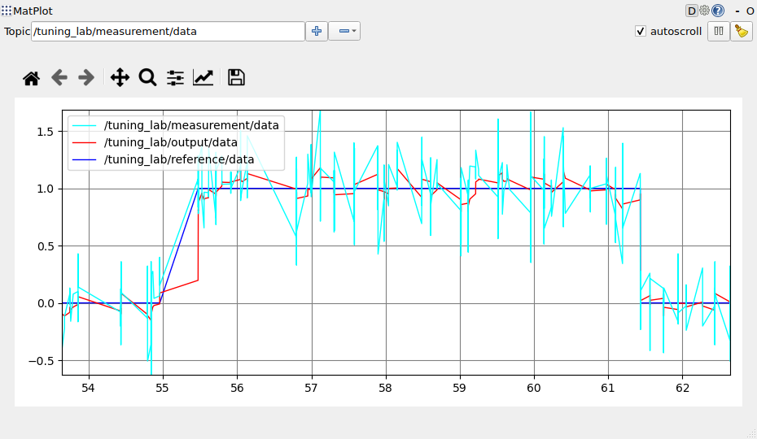
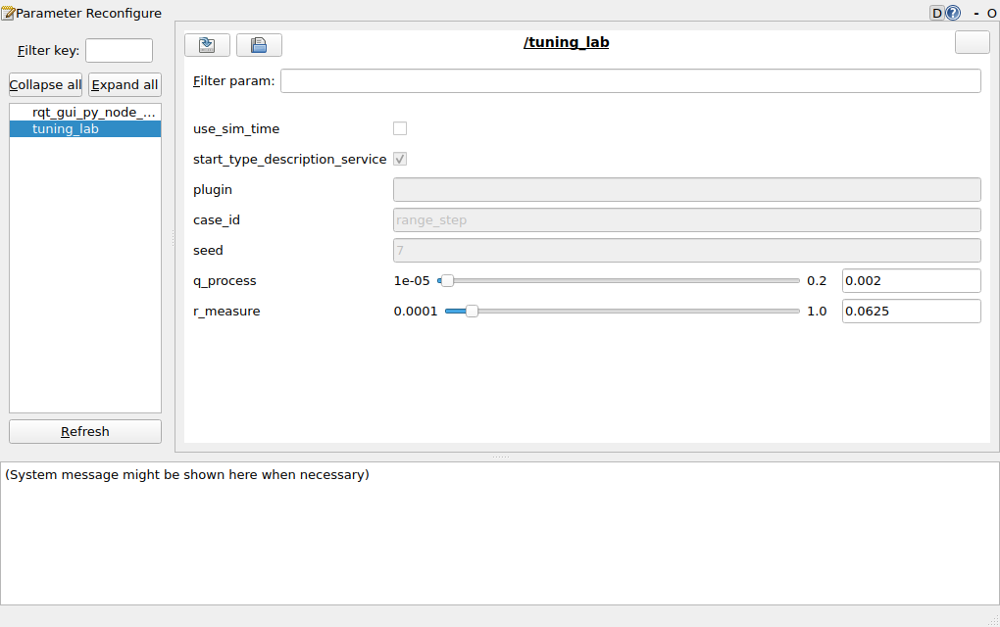
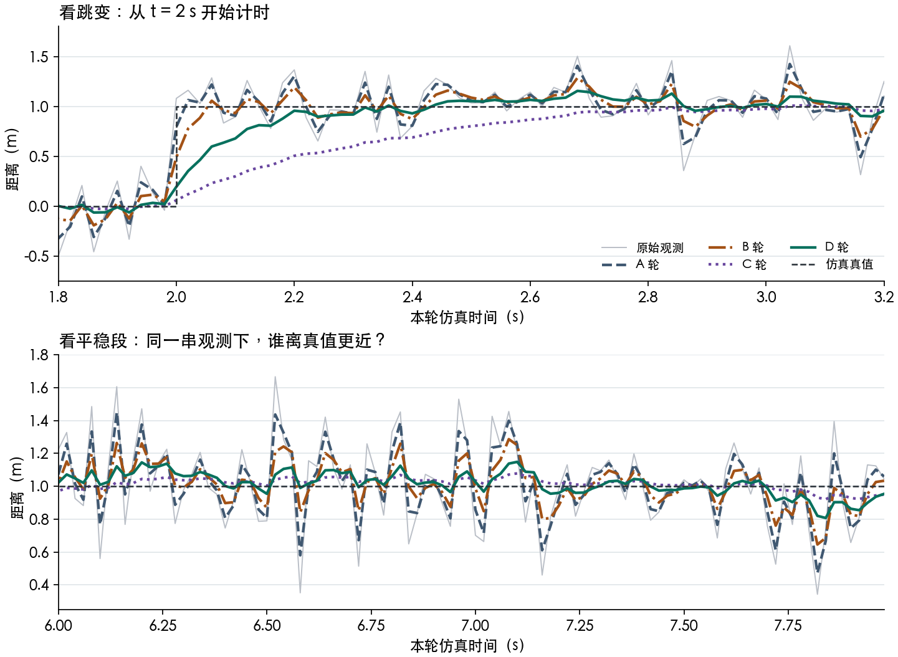

# Kalman 滤波：让距离估计更稳，也能及时跟上台阶

测距实验里没有控制电机。这次看三条距离：仿真器知道的真值、传感器报出的带噪读数、滤波器给出的估计。真值在每轮第 2 秒从 0 跳到 1 m。滤波器只获得测量值，真值用于课后评分。

**任务标准**：阶跃后估计首次达到 **0.90 m 的延迟 ≤ 0.30 s**，最后 2 秒估计相对真值的**均方根误差（RMSE）≤ 0.09 m**。默认随机种子为 7，每次重跑使用同一串噪声，便于逐轮比较。

## 1. 给原有的曲线加上原始读数

首次安装见[轮速环入门](../../first-wheel/README.md)。先按[实验准备](../README.md)更新工作区，在终端 A 运行：

```bash
source /opt/ros/jazzy/setup.bash
source ~/rm_ws/install/setup.bash
ros2 launch rm_tuning_lab lesson.launch.py case_id:=range_step
```

默认曲线图已有 `/tuning_lab/reference/data`（真值）和 `/tuning_lab/output/data`（估计）。在同一窗口上方的 Topic 框输入 **`/tuning_lab/measurement/data`** 并点 **+**。三条线单位都是米。先认出最毛糙的原始观测，再找平稳的台阶真值，剩下的是估计。读延迟时从真值跳变的竖边开始，沿横轴找到估计第一次跨过 0.90 m 的点。



*D 轮三条线同窗。按图例找 measurement（原始观测）和 output（估计），观察阶跃前后各自的抖动。*

## 2. 先用传感器确定 R，再用任务确定 Q

在 Param 窗口左侧单击 `tuning_lab`，数值框内每次按 Enter 提交。R 是**测量误差方差**，本例传感器噪声标准差为 0.25 m，对应 `r_measure=0.25²=0.0625` m²。Q 是随机游走模型**每一拍**的过程方差，表示允许状态在两次读数之间变化多少。这里的 Q 和 R 用于估计不确定性，与 LQR 课中的代价权重意义不同。



*面板实拍为最终的 D 轮；第一次练习先按表中 A 轮输入。*

| 轮次 | 怎么改 | 观察哪一段 |
|---|---|---|
| A · 起点 | `q_process=0.02`、`r_measure=0.01` | 滤波器很信当前读数。看阶跃后响应有多快，再看最后 2 秒仍留下多少抖动。 |
| B · 校正测量方差 | 保持 Q，只把 `r_measure` 改为 **0.0625** | 对同一串原始观测，估计的平稳段误差下降。 |
| C · 试一个很小的 Q | 保持 R，只把 `q_process` 降到 **0.0002** | 估计很平滑，却在第 2 秒发生真实跳变时明显落后。 |
| D · 找回响应速度 | 只把 `q_process` 提到 **0.002** | 对照 C 的阶跃段与 B 的平稳段，检查延迟和误差是否同时合格。 |



## 3. 分开测延迟与抖动

| 轮次 | 首达 0.90 m 延迟（s） | 估计 RMSE（m） | 原始观测 RMSE（m） |
|---|---:|---:|---:|
| A | 0.02 | 0.1962 | 0.2630 |
| B | 0.06 | 0.1274 | 0.2630 |
| C | 0.66 | 0.0381 | 0.2630 |
| D | 0.20 | 0.0716 | 0.2630 |

**D 轮通过。** C 轮平稳段误差最小，却要 0.66 s 才跨过 0.90 m。D 轮将延迟缩短至 0.20 s，估计误差为 0.0716 m，低于同一段原始观测的 0.2630 m。

在另一个终端运行下列命令，采样时保持参数不变。平稳段取本轮 `6.00 ≤ t < 8.00 s` 的 100 个采样点，逐点用估计减真值，误差平方取平均后再开平方。脚本也会给出原始观测的 RMSE 作为比较。

```bash
source /opt/ros/jazzy/setup.bash
source ~/rm_ws/install/setup.bash
python3 ~/rm_ws/src/rm-tuning-lab/tools/score_trial.py
```

单次越过阈值可能受噪声影响，因此还要同时检查平稳段 RMSE。若改变随机种子，具体数字也会改变。本课验收使用固定种子 7 的同一组读数。[下载四轮原始话题数据](samples.csv)

本课最终验收通过后，关闭本课窗口，继续[第五课 · 给自己的轮组加负载](../../custom-chassis/README.md)。也可[返回首页查看整条路线](../../../README.md)。
