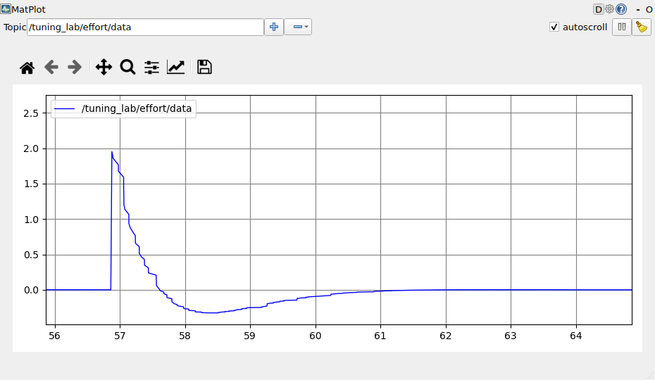
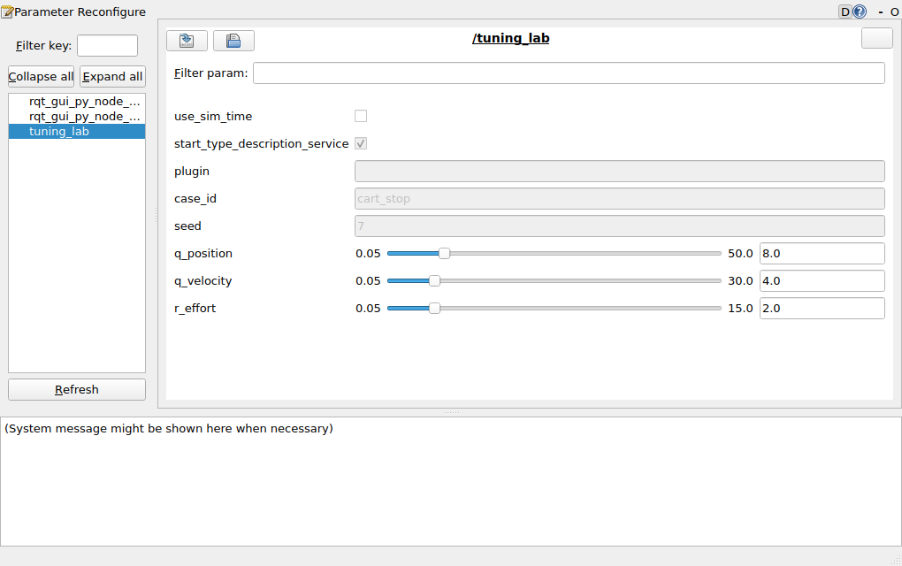
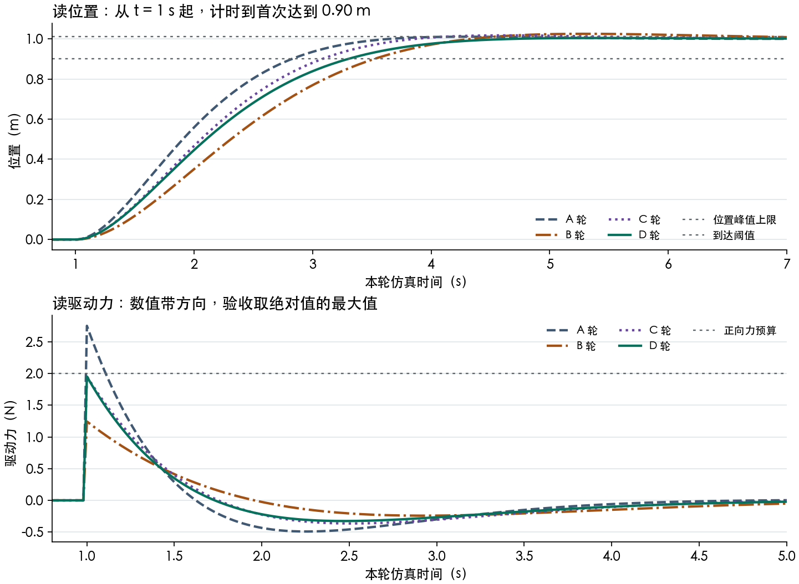

# LQR：让小车在 2 N 推力预算内停到 1 m

这台 1 kg 模拟滑台同时反馈位置和速度。LQR 的三个旋钮是代价权重：`q_position` 让位置误差更“贵”，`q_velocity` 让速度更“贵”，`r_effort` 让用力更“贵”。节点根据这些权重计算反馈增益。这一课固定位置权重，先给驱动力订预算，再调靠近终点时的刹车。

**任务标准**：整个周期内驱动力的**绝对值峰值 ≤ 2.00 N**；阶跃后首次到 0.90 m 的时间 **≤ 2.40 s**；最高位置 **≤ 1.01 m**。模型的执行器硬限幅为 ±4 N，任务要求留出了余量。

## 1. 一扇窗看米，一扇窗看牛顿

首次安装见[轮速环入门](../../first-wheel/README.md)，之前的工作区按[实验准备](../README.md)更新。终端 A 运行：

```bash
source /opt/ros/jazzy/setup.bash
source ~/rm_ws/install/setup.bash
ros2 launch rm_tuning_lab lesson.launch.py case_id:=cart_stop
```

保留默认的位置图，`reference` 是目标、`output` 是实际位置。在终端 B 单独打开力的图：

```bash
source /opt/ros/jazzy/setup.bash
source ~/rm_ws/install/setup.bash
ros2 run rqt_plot rqt_plot -e
```

在新窗口的 Topic 框输入 `/tuning_lab/effort/data`，点 **+**。正力推动滑台前进，负力用于制动；判断是否超预算要看离零最远的那个点。位置窗横轴上，从目标跳到 1 m 的竖边开始计时。



*D 轮的力先上升到约 1.95 N，随后穿过零线刹车，最后回到零附近。*

## 2. 先找合适的用力成本，再压过冲

参数面板左边选 `tuning_lab`，右边数值框 Ctrl+A 输入后按 Enter。每轮等一次完整阶跃再读数。



*面板实拍为最终的 D 轮；第一次练习先按表中 A 轮输入。*

| 轮次 | 怎么改 | 曲线上找什么 |
|---|---|---|
| A · 基线 | `q_position=8.0`、`q_velocity=2.0`、`r_effort=1.0` | 位置起步快，先看阶跃瞬间用了多少力。 |
| B · 省力 | 只把 `r_effort` 提到 **5.0** | 力峰降低；检查位置到 0.90 m 是否迟于预算。 |
| C · 折中 | 只把 `r_effort` 调回 **2.0** | 力和到达时间已能兼顾，放大位置最高点，看有没有越过 1.01 m。 |
| D · 减少过冲 | 保持 `r_effort=2.0`，只把 `q_velocity` 从 2 调到 **4.0** | 系统在接近终点时更克制，位置峰值下降。再次检查速度代价是否让到位用时超标。 |



## 3. 三项约束需在同一轮通过

| 轮次 | 最大绝对推力（N） | 首达 0.90 m（s） | 位置峰值（m） |
|---|---:|---:|---:|
| A | 2.7512 | 1.84 | 1.0106 |
| B | 1.2434 | 2.54 | 1.0251 |
| C | 1.9558 | 2.10 | 1.0173 |
| D | 1.9516 | 2.32 | 1.0043 |

**D 轮通过。** B 轮最省力，却要 2.54 s 才到 0.90 m。C 轮到达时间缩至 2.10 s，最高位置仍有 1.0173 m。D 轮提高速度权重后，多花 0.22 s 换来更小的过冲，三项都在预算内。

在终端 C 执行以下命令，保持当前参数直至输出结果。到达时间从本轮第 1 秒的阶跃开始计算，2.40 秒的预算对应本轮时刻 3.40 s。

```bash
source /opt/ros/jazzy/setup.bash
source ~/rm_ws/install/setup.bash
python3 ~/rm_ws/src/rm-tuning-lab/tools/score_trial.py
```

力超预算时，先固定两个 Q，提高 R；力合格但过冲偏大时，再小幅提高速度权重。每次都把到达时间记下来，防止为压低峰值而错过期限。[下载四轮原始话题数据](samples.csv)
